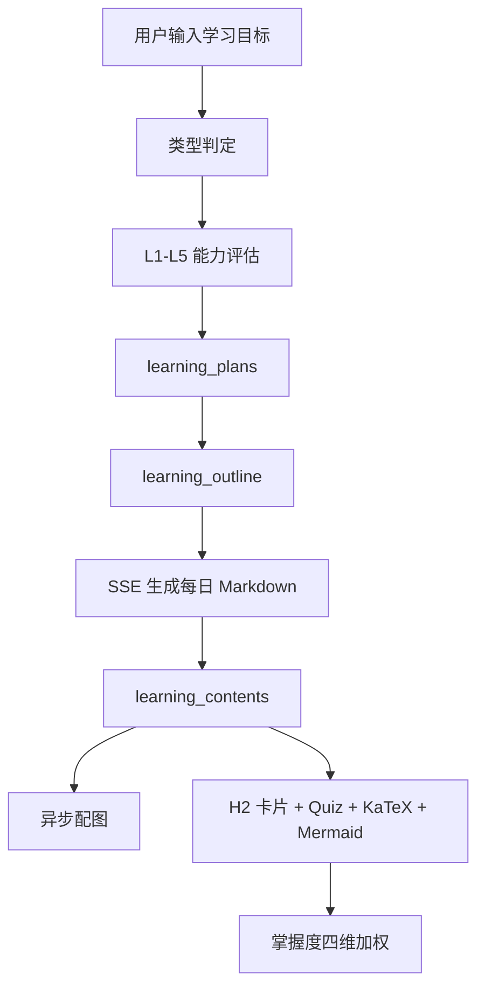
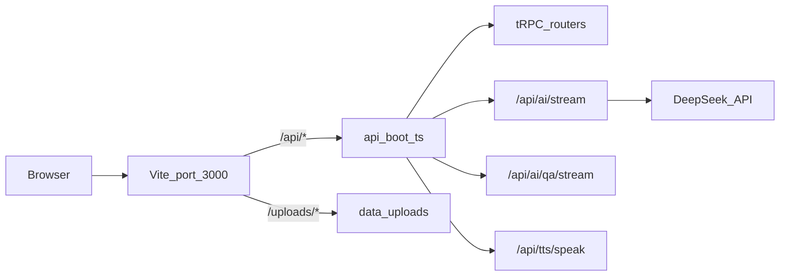
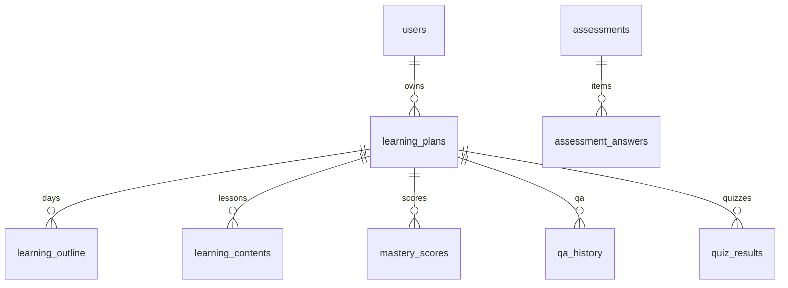

# 弈智项目通读：架构、实现与评估

> 本文档基于对代码库 UI、后端、数据库与产品设计的完整通读整理，用于开发维护与后续迭代决策。  
> 最后更新：2026-08-20

---

## 目录

1. [产品定位与核心流程](#1-产品定位与核心流程)
2. [整体架构](#2-整体架构)
3. [UI 与用户旅程](#3-ui-与用户旅程)
4. [后端与性能](#4-后端与性能)
5. [数据库与数据模型](#5-数据库与数据模型)
6. [共享层与类型引擎](#6-共享层与类型引擎)
7. [设计评价与架构债](#7-设计评价与架构债)
8. [后续迭代建议](#8-后续迭代建议)

---

## 1. 产品定位与核心流程

**产品名**：弈智（Yizhi）

**定位**：基于 DeepSeek 的 AI 自适应学习平台。用户输入**学习目标**（如「Python 量化交易」），而非粘贴原始教材；系统判定 7 类学习引擎，生成 N 天大纲、每日 Markdown 课、配图、测验与掌握度分析。

**技术栈**：React 19 + Vite 7 + Hono 4 + tRPC 11 + Drizzle/MySQL；LLM 用 DeepSeek；可选阿里云万相插画、火山引擎 TTS、Qwen-VL 配图校验。



### 主链路概览

| 阶段 | 用户操作 | 输出形态 |
|------|----------|----------|
| 登录 | 手机号 + OTP | JWT + Cookie |
| Onboarding | 输入目标、选天数 | 类型判定 → 评估 L1–L5 → JSON 大纲 |
| Dashboard | 切换/管理计划 | 计划列表、今日课、掌握度环 |
| Study | 点击「生成学习内容」 | SSE 流式 Markdown → 卡片阅读 + QA + TTS |
| Mastery / History | 查看进度与问答 | 聚合统计与历史记录 |

---

## 2. 整体架构

### 2.1 分层结构

| 层 | 职责 | 关键入口 |
|----|------|----------|
| **UI** | 页面旅程、阅读体验、响应式布局 | [`src/App.tsx`](../src/App.tsx) |
| **客户端状态** | 当前计划/天/大纲（按 userId 隔离） | [`src/stores/useLearningStore.ts`](../src/stores/useLearningStore.ts) |
| **API** | CRUD 走 tRPC；长流走 SSE | [`api/boot.ts`](../api/boot.ts)、[`api/router.ts`](../api/router.ts) |
| **共享层** | Prompt 模板、Markdown 切分、TTS 文本、配图标记 | [`shared/`](../shared/) |
| **持久化** | MySQL 13 表 + 磁盘配图 | [`db/schema.ts`](../db/schema.ts)、`data/uploads/` |

### 2.2 开发态请求流

开发模式下 Vite 与 Hono 通过 `@hono/vite-dev-server` 同进程运行，**统一端口 3000**：



生产：`npm run build` → `dist/boot.js` + `dist/public/`；`npm start` 启动 Node 进程。

### 2.3 协议分裂（有意设计）

tRPC 不承载长 SSE，以下能力为独立 Hono 路由：

| 路由 | 用途 |
|------|------|
| `POST /api/ai/stream` | 每日内容 SSE 流式生成 |
| `POST /api/ai/qa/stream` | 问答 SSE，流结束后写库 |
| `POST /api/tts/speak` | 单句 TTS，返回 `audio/mpeg` |
| `GET /uploads/*` | 配图静态资源 |

这是合理设计：tRPC `httpLink` 不适合长连接 token 流。

### 2.4 tRPC 路由树

```
ping
auth / phoneAuth / user
ai（非流：类型判定、大纲、评估题）
learning / content / qa / mastery / assessment
generation（已实现，前端未使用）
```

---

## 3. UI 与用户旅程

### 3.1 路由与鉴权

| 路径 | 页面 | 鉴权 | 职责 |
|------|------|------|------|
| `/login` | Login | 公开 | 手机号 OTP（开发码 `123456`） |
| `/onboarding` | Onboarding | 需登录 | 新建计划向导 |
| `/` | Dashboard | 需登录 | 计划看板、进度、掌握度环 |
| `/study` | Study | 需登录 | 每日学习、QA、TTS、配图 |
| `/mastery` | Mastery | 需登录 | 掌握度分析 |
| `/history` | History | 需登录 | QA 历史 |
| `/settings` | Settings | 需登录 | 主题、通知、个人资料 |
| `*` | NotFound | 公开 | 404 |

**鉴权守卫**：[`src/App.tsx`](../src/App.tsx) 中 `AuthenticatedLayout` 依赖 `useAuth` → `trpc.user.me`；未登录重定向 `/login`。

### 3.2 布局与响应式

**全局壳**：[`AppLayout.tsx`](../src/components/layout/AppLayout.tsx)

- **桌面（≥768px）**：左侧固定导航栏（220–240px）+ 主内容区 + Framer Motion 页面过渡
- **移动（<768px）**：顶栏 + 底部 Tab 导航（5 项）+ `safe-area-pb`

**Study 页三栏**（核心学习界面）：

- 左：日大纲（桌面固定侧栏 / 移动抽屉）
- 中：阅读区（SectionCard + 工具栏 + 进度条）
- 右：QA 面板（桌面 360px / 移动全屏 overlay）

### 3.3 状态管理

| 来源 | 存储 | 内容 |
|------|------|------|
| Zustand | `localStorage: yizhi_learning_state_{userId}` | currentPlanId、currentDay、outline、goal |
| React Query | 内存 + 5min staleTime | 服务端 plans、content、mastery 等 |
| 本地 prefs | `yizhi-reading-prefs` | 阅读模式、字号、行距、专注模式 |
| 主题 | `yizhi_settings` | dark/light |
| Token | `yizhi_token` | JWT |

**用户切换**：`useAuth` 检测 userId 变化 → `switchUser` 隔离 localStorage；登出 → `reset` + 全页 reload。

### 3.4 学习内容呈现（输出形态）

用户**不粘贴原文**。Study 触发生成后：

1. **SSE 流式输出** Markdown 全文
2. **持久化** 至 `learning_contents.markdown_content`
3. **前端解析渲染**：
   - `splitContentWithQuizzes()` → 分离正文与 `<!-- quiz -->` 块
   - `splitMarkdownByH2()` → 按 `##` 拆成 **SectionCard** 卡片
   - Quiz → **QuizCard** 交互组件
   - Mermaid → **MermaidDiagram**
   - 公式 → KaTeX（`$...$` / `$$...$$`）
4. **异步配图**：`runIllustrationJob` 后台插入图片；前端 15s × 12 轮询 `getContent`

**Markdown 内嵌格式**：

```markdown
<!-- illustration: {"anchor":"正文句子","intent":"画面描述","medium":"wanxiang|mermaid"} -->

<!-- quiz
question: 题目
A: 选项A
B: 选项B
C: 选项C
D: 选项D
correct: B
explanation: 解析
-->
```

**类型模板差异**：[`shared/typeEngine.ts`](../shared/typeEngine.ts) 中 7 类各有独立章节结构（如抽象逻辑偏推导、操作逻辑偏可运行代码、语言偏场景对话）。但 Study 页的 user prompt 仍是通用模板（讲解/代码/场景/练习/小结），与 system prompt 的精细结构**叠加**，模型输出可能混用两套指令——这是已知的产品/实现张力点。

### 3.5 Onboarding 状态机

```
welcome → input → detecting_type → generating_quiz → assessing
  → generating_plan → complete | limit
```

关键 API 链：`detectLearningType` → `generateAssessmentQuestions` → `assessment.*` → `createPlan` → `generateOutline` → `saveOutline` → 跳转 Dashboard（非 `/study`）。

### 3.6 UI 层已暴露的缺口

| 问题 | 位置 | 说明 |
|------|------|------|
| 连续学习天数写死 | AppLayout、Dashboard | 显示「7 天」，非 API 数据 |
| 无自动 onboarding | App.tsx | 新用户需手动发现 `/onboarding` |
| 计划不自动预选 | Dashboard | 有计划但无 currentPlanId 时不预选最新 |
| Mastery/History 不 restore | 对应页面 | Study 会自动 restore 首个计划，这两页不会 |
| 锁图标不拦截 | StudyDayOutline | 未来天可点击，锁仅为视觉 |
| `paused` 无 UI | schema 有 | 暂停/恢复未实现 |
| 亮色主题 hack | index.css | 大量 `!important` 覆盖硬编码 hex |
| 未挂载组件 | StreamOutput、Sonner Toaster | 存在但未使用 |
| 通知无调度 | Settings | 仅测浏览器权限，无每日 cron |
| NotFound 风格不一致 | NotFound.tsx | 英文 + shadcn，其余为中文 liquid-glass |

---

## 4. 后端与性能

### 4.1 鉴权链路

每次请求：`Authorization: Bearer` 或 Cookie `yizhi_token` → JWT 验证 → **DB 查 users 表**。无服务端 session 缓存。

### 4.2 AI 服务

**客户端**：[`src/services/aiService.ts`](../src/services/aiService.ts)  
**服务端**：[`api/services/aiService.ts`](../api/services/aiService.ts) → [`api/lib/deepseek.ts`](../api/lib/deepseek.ts)

| 功能 | 模式 | max_tokens | 说明 |
|------|------|------------|------|
| detectLearningType | sync | 200 | 失败 fallback `abstract_logic` |
| generateOutline | sync | 8192 | JSON 解析 + 文本 fallback |
| generateAssessmentQuestions | sync | 4000 | `response_format: json_object` |
| streamContent | SSE | 8192 | `getTypeSystemPrompt` + user prompt |
| streamQA | SSE | 4000 | 当日全文 + 历史 20 轮 |

### 4.3 热路径延迟与瓶颈

| 路径 | 特征 | 风险等级 |
|------|------|----------|
| 大纲生成 | 一次请求最多 365 天 | 长计划易截断/JSON 解析失败 |
| 每日内容 SSE | 流式，首 token 快 | DeepSeek **无 fetch timeout** |
| **配图管线** | saveContent 后 fire-and-forget | **主瓶颈**：万相串行 + 视觉校验 + retry，1–3 分钟；无任务状态 |
| QA | 4 路并行读库 | prompt 含全文 + 20 轮历史，线性膨胀 |
| TTS | 按句请求 + 客户端预取 | 合理；服务端无缓存 |
| 鉴权 | 每请求 JWT + DB | 可缓存 user，目前未做 |

### 4.4 配图管线

```
saveContent
  └─ void runIllustrationJob() [无状态跟踪]
       ├─ 解析 <!-- illustration --> 或 DeepSeek 提取 sceneBrief
       ├─ 分流：wanxiang（场景）/ mermaid（概念图，客户端渲染）
       ├─ 万相：串行生成 → 可选 Qwen-VL 校验 → retry
       └─ UPDATE markdownContent
```

- 存储：`data/uploads/content-images/{planId}/{dayNumber}/{n}.png`
- 前端：保存后 15s 间隔轮询 12 次（共 3 分钟）
- [`generation_tasks`](../db/schema.ts) 表与 [`generation-router.ts`](../api/generation-router.ts) **已实现但前端未使用**

### 4.5 掌握度算法

实现于 [`api/services/masteryService.ts`](../api/services/masteryService.ts)：

```
MasteryScore = min(100, round(
  StudyTimeScore   × 0.25 +
  QAScore          × 0.20 +
  QuizScore        × 0.40 +
  FrequencyScore   × 0.15
))
```

答题权重衰减：第 1 次 1.0 → 第 2 次 0.7 → 第 3 次 0.5 → 第 4 次+ 0.3。

**实现偏差**：`consecutiveDays` 在调用处**写死为 1**，频率维（15%）恒为常数 ~14.3 分。

### 4.6 后端安全与一致性问题

| 问题 | 严重度 | 说明 |
|------|--------|------|
| content-router 缺 plan 归属校验 | 高 | 任意登录用户可读/写他人 planId 的内容（IDOR） |
| 无 AI/TTS/配图限流 | 中 | 成本与滥用风险 |
| deletePlan 无事务 | 中 | 8+ 顺序 DELETE，失败可能半删 |
| deletePlan 漏删 generation_tasks | 低 | 孤儿行 |
| DEV_MODE 写死 true | 低 | phone-auth 始终接受 `123456` |
| 无 DeepSeek/TTS timeout | 中 | 请求挂起风险 |
| QA 流中断不保存 | 低 | abort 时 partial answer 丢失 |

### 4.7 外部依赖与环境变量

详见 [`api/lib/env.ts`](../api/lib/env.ts) 与 [README](../README.md)。

| 服务 | 必填 | 用途 |
|------|------|------|
| MySQL | 是 | 持久化 |
| DeepSeek | 是 | LLM 全链路 |
| JWT_SECRET | 是 | 鉴权 |
| DashScope | 否 | 万相插画 + Qwen-VL 校验 |
| Volcengine TTS | 否 | 语音朗读 |

---

## 5. 数据库与数据模型

### 5.1 表清单（13 张）

| 分类 | 表名 | 用途 |
|------|------|------|
| 认证 | users, verification_codes | 手机号登录 |
| 学习核心 | learning_plans, learning_outline, learning_contents | 计划/大纲/每日内容 |
| 评估 | assessments, assessment_answers | Onboarding L1–L5 |
| 互动 | qa_history, quiz_results, mastery_scores | 问答/测验/掌握度 |
| 追踪 | study_sessions, generation_tasks | **schema 存在，业务未完整使用** |

### 5.2 关系（应用层维护，无 DB 外键）



### 5.3 索引现状

- **仅有** `users.phone` UNIQUE
- **无** `(plan_id, day_number)`、`(user_id, status)` 等热路径索引
- PlanetScale 模式：无外键约束

### 5.4 数据生命周期

```
1. 评估 INSERT (plan_id=0) → 答题 → complete → skillLevel
2. createPlan → updatePlanId 关联评估
3. saveOutline：DELETE 旧大纲 + bulk INSERT 新大纲（无版本）
4. Study 懒生成：UPSERT learning_contents
5. 配图：UPDATE markdownContent（磁盘存图）
6. 互动：qa_history / quiz_results → 重算 mastery_scores
7. deletePlan：手动级联 8 表（漏 generation_tasks）
```

### 5.5 设计与实现偏离

| 设计意图（README/schema） | 实际代码 |
|---------------------------|----------|
| `study_sessions` 记录学习时长 | **从未 INSERT**；时长在 `mastery_scores.study_minutes` |
| 掌握度 15% 连续学习频率 | `consecutiveDays` 写死 1 |
| `learning_plans.current_day` | 前端不调 `updateProgress`，进度在 localStorage |
| `paused` 暂停计划 | schema 有，无 API/UI |
| `generation_tasks` 任务状态 | 路由存在，前端用 Zustand 假进度 |
| 正式迁移 | snapshot 缺 3 表 + 列；依赖 `db:push` 与手写脚本 |

### 5.6 建议补充索引

```sql
-- 示例（需通过 Drizzle migration 落地）
learning_plans(user_id, status, created_at)
learning_outline(plan_id, day_number) UNIQUE
learning_contents(plan_id, day_number) UNIQUE
qa_history(plan_id, user_id, day_number, created_at)
mastery_scores(user_id, plan_id, knowledge_name) UNIQUE
quiz_results(user_id, plan_id, knowledge_name, created_at)
```

---

## 6. 共享层与类型引擎

[`shared/typeEngine.ts`](../shared/typeEngine.ts) 是产品内核，前后端共用：

| 能力 | 函数 |
|------|------|
| 类型判定 | `getTypeDetectionPrompt` / `parseTypeFromAIResponse` |
| 内容生成 system prompt | `getTypeSystemPrompt(type, skillLevel)` |
| 大纲 prompt | `getTypeOutlinePrompt` |
| 评估题 prompt | `getTypeAssessmentPrompt` |
| 配图配额 | `applyIllustrationQuotas` |

**7 类学习引擎**：

| 类型 | 英文名 | 典型场景 |
|------|--------|----------|
| 抽象逻辑型 | abstract_logic | 数学、物理、统计 |
| 操作逻辑型 | operation_logic | 编程、软件、工具 |
| 语言学习型 | language | 英语、日语等 |
| 网络关联型 | network_assoc | 历史、法律、政治 |
| 模型应用型 | model_apply | 金融、经济、管理 |
| 感知表达型 | perception | 绘画、摄影、写作 |
| 实践技艺型 | practical | 烹饪、驾驶、急救 |

其他共享模块：

| 文件 | 用途 |
|------|------|
| `shared/markdownSections.ts` | H2 章节切分 |
| `shared/illustrationMarkers.ts` | 配图标记解析/剥离 |
| `shared/textForTts.ts` | TTS 句子切分 |
| `contracts/` | 共享类型与错误码 |

---

## 7. 设计评价与架构债

### 7.1 做得对的地方

1. **类型引擎集中化** — 产品差异在 prompt 层，而非散落 UI
2. **大纲先行 + 按天懒生成** — 控制首次等待与 API 成本
3. **Markdown 自包含** — quiz/illustration 注释让 AI 一次输出驱动交互
4. **阅读栈完成度高** — H2 卡片、TOC、字号、专注、KaTeX、Mermaid
5. **QA 按 plan+day 隔离** — 上下文边界清晰
6. **开发一体进程** — Vite + Hono 同端口，类型从 schema 贯通前后端
7. **SSE 与 tRPC 分工明确** — 长流不走 tRPC

### 7.2 文档承诺 vs 代码

README 与 [`functional-requirements.md`](functional-requirements.md) 描述了暂停计划、`study_sessions` 写入、连续学习频率、生成任务状态等能力——**部分尚未落地**。掌握度公式文档完整，运行时频率维为常数。

### 7.3 架构债（按影响排序）

| 优先级 | 问题 | 影响 |
|--------|------|------|
| P0 | 配图无队列/状态，串行 + 轮询 | 用户体验、可观测性 |
| P0 | content 接口缺 plan 归属校验 | 安全（IDOR） |
| P1 | 无热路径索引 | 多用户扩展性 |
| P1 | deletePlan 无事务 | 数据一致性 |
| P1 | 进度双源（Zustand vs DB） | 跨设备不同步 |
| P2 | 掌握度频率维未实现 | 产品指标失真 |
| P2 | generation 路由死代码 | 维护负担 |
| P2 | 迁移与 schema 漂移 | 环境不一致 |
| P3 | UI 缺口（streak、onboarding 引导等） | 产品 polish |

### 7.4 总体判断

当前是**功能完整的产品原型**：主学习闭环（目标 → 大纲 → 流式课 → 测验/问答 → 掌握度展示）已打通；多用户规模、任务可靠性、数据一致性与部分 README 承诺的能力，尚未按生产标准收口。

---

## 8. 后续迭代建议

按目标单独立项，避免一次大改：

### A. 改进学习内容输出形态

- 统一 Study user prompt 与 `getTypeSystemPrompt` 的章节结构，消除双 prompt 张力
- 可选：按类型定制前端 SectionCard  accent / 阅读引导文案

### B. 补设计漏洞（推荐优先）

1. content-router 增加 plan 归属校验
2. 补充 Drizzle migration 与热路径索引
3. 实现 `consecutiveDays` 真实计算（写入 `study_sessions` 或基于 `updated_at` 聚合）
4. 前端调用 `learning.updateProgress` 或废弃 DB `current_day` 字段
5. deletePlan 加事务 + 补删 generation_tasks

### C. 后端性能优化

1. 配图：接入 `generation_tasks` 或轻量 job 状态；万相有限并发（如 2）
2. DeepSeek/TTS 加 fetch timeout + 重试策略
3. 客户端轮询改 SSE/WebSocket 推送或 long-poll with etag
4. JWT 用户 lookup 短缓存（如 60s LRU）

### D. UI 体验补齐

1. 新用户/无计划自动引导 onboarding
2. Dashboard 自动预选最新 active 计划
3. Mastery/History 与 Study 一致的 plan restore
4. 连续学习天数 API 化
5. 挂载 Toaster、统一 NotFound 风格

---

## 附录：关键文件索引

| Concern | Path |
|---------|------|
| 前端路由 | `src/App.tsx` |
| 学习状态 | `src/stores/useLearningStore.ts` |
| Study 页 | `src/pages/Study.tsx` |
| 内容渲染 | `src/components/reading/*`, `src/components/markdown/*` |
| Quiz | `src/components/quiz/QuizRenderer.tsx` |
| 后端入口 | `api/boot.ts` |
| tRPC 聚合 | `api/router.ts` |
| AI 服务 | `api/services/aiService.ts` |
| 配图 | `api/services/contentImageService.ts` |
| 掌握度 | `api/services/masteryService.ts` |
| QA | `api/services/qaService.ts` |
| 类型引擎 | `shared/typeEngine.ts` |
| Schema | `db/schema.ts` |
| 功能链路 | `docs/functional-requirements.md` |
